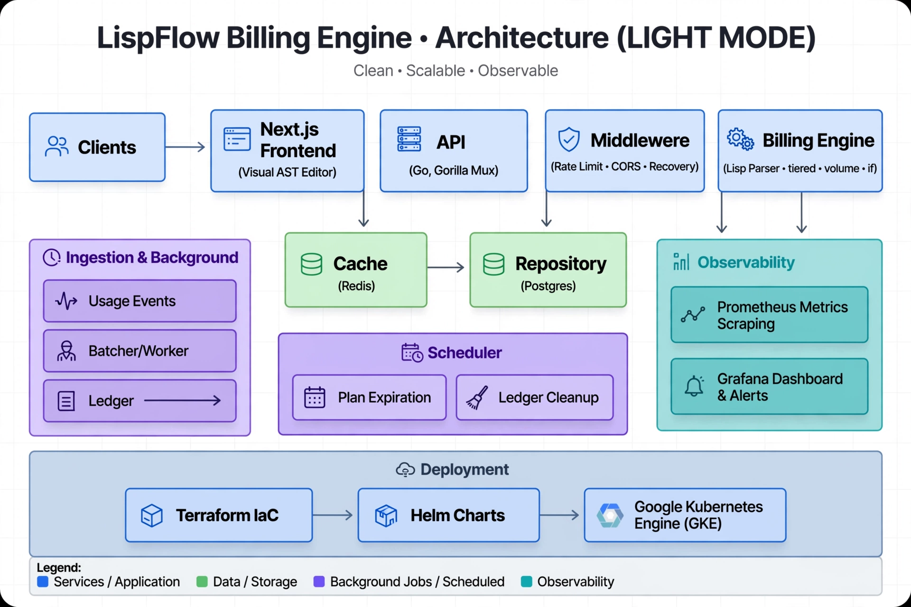
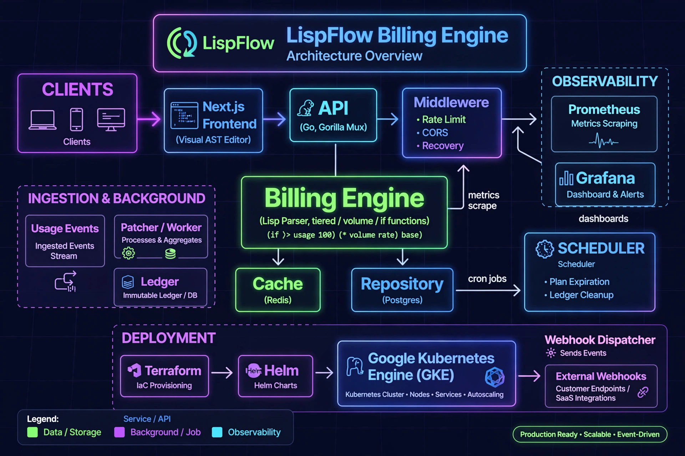

# LispFlow - Lisp-Based Usage Metering & Billing Engine

<picture>
  <source media="(prefers-color-scheme: dark)" srcset="./docs/architecture.webp">
  <source media="(prefers-color-scheme: light)" srcset="./docs/architecture-light.webp">
  
</picture>




Production-ready metering with Lisp pricing expressions. Built with Go, Next.js, Postgres, Redis, GKE.

## Architecture

Clients → Next.js Visual AST Editor → Go API (Gorilla Mux) → Middleware (Rate Limit, CORS, Recovery) → Billing Engine (Lisp Parser)
  → Cache (Redis) + Repository (Postgres) + Ledger (immutable)
  → Batcher / Worker (100 events / 5s flush)
  → Webhook Dispatcher (async, 3 retries)
  → Prometheus metrics → Grafana dashboards
  → Scheduler (plan expiration, ledger cleanup every hour)
  → Terraform → Helm → GKE

See [architecture.webp](./docs/architecture.webp) for full diagram.

## Quick Start
```bash
make deps && docker compose up --build
# API http://localhost:8080
# Frontend http://localhost:3000
# Prometheus http://localhost:9090
# Grafana http://localhost:3000 (admin/admin)
```

## Lisp DSL
- `(+ api_calls 10)` , `(* api_calls 0.01)`
- `(tiered api_calls 0.01 1000 0.008 10000 0.005)` - graduated tiers
- `(volume api_calls 1000 0.01 10000 0.008 0.005)` - volume pricing
- `(max 5 (min 100 (* api_calls 0.01)))` - caps
- `(if (> api_calls 1000) (* api_calls 0.009) (* api_calls 0.01))` - discounts
- Missing metrics default to 0, max plan size 16KB

## API (OpenAPI 3.0)
- POST /customers/{id}/plans - create/update with versioning
- POST /customers/{id}/evaluate - single event
- POST /customers/{id}/batch - batch (metrics: lispflow_batch_size)
- GET  /customers/{id}/history?limit=20&offset=0 - immutable ledger, pagination
- POST /simulate - time-travel simulation, revenue impact
- POST /validate - validate Lisp expression
- GET /health, /ready, /metrics (Prometheus)

## Integration Tests
```bash
make integration
# or
go test -v -tags=integration ./tests/integration/...
```
11 tests: activation/versioning, tiered, multi-dim min/max caps, conditional discounts, missing keys→0, simulation, invalid rejection, batch, ledger pagination/immutability, 100 concurrent, size limits.

## Infra
```bash
cd terraform/backend-bootstrap && terraform apply
cd terraform/environments/staging && terraform init && terraform apply
helm lint ./helm/lispflow
helm install lispflow ./helm/lispflow --create-namespace --namespace lispflow --set monitoring.enabled=true
```

## Monitoring
- PrometheusRule: HighEvaluationErrorRate (>5% 2m), SlowEvaluations (P95>500ms), BatcherLag (>900)
- Grafana dashboard: evals/sec, P95 latency, ledger growth, active plans, batch heatmap, error rate
- Files: monitoring/grafana-dashboard.json, monitoring/prometheus.yml

## Production Hardening
- Redis cache (plan caching, 5m TTL)
- Webhook dispatcher (WEBHOOK_URLS env, async, exponential backoff)
- Middleware: IP rate limiting (100 rps, burst 200), CORS, Recovery
- Scheduler: hourly plan expiration + 90-day ledger cleanup
- HPA: CPU 70%, Memory 80%, fast scale-up, slow scale-down
- PodAntiAffinity for HA

# LispFlow - Lisp Billing Engine

Production-ready metering with Lisp pricing expressions.

## Quick Start
```bash
make deps && make run
# or
docker compose up --build
```

## Lisp DSL
- `(+ api_calls 10)` , `(* api_calls 0.01)`
- `(tiered api_calls 0.01 1000 0.008 10000 0.005)` - graduated tiers
- `(volume api_calls 1000 0.01 10000 0.008 0.005)` - volume pricing
- `(max 5 (min 100 (* api_calls 0.01)))` - caps
- `(if (> api_calls 1000) (* api_calls 0.009) (* api_calls 0.01))` - discounts
- Missing metrics default to 0

## API
POST /customers/{id}/plans
POST /customers/{id}/evaluate
POST /customers/{id}/batch
GET  /customers/{id}/history?limit=20&offset=0
POST /simulate
POST /validate

## Tests
make integration

## Infra
cd terraform/backend-bootstrap && terraform apply
cd terraform/environments/staging && terraform apply
helm install lispflow ./helm/lispflow

